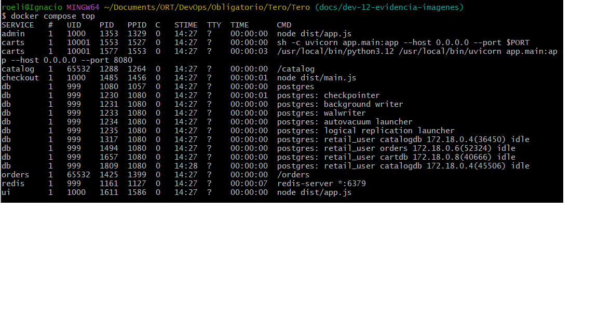
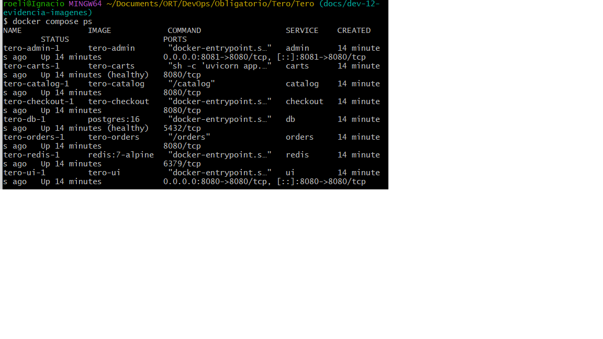
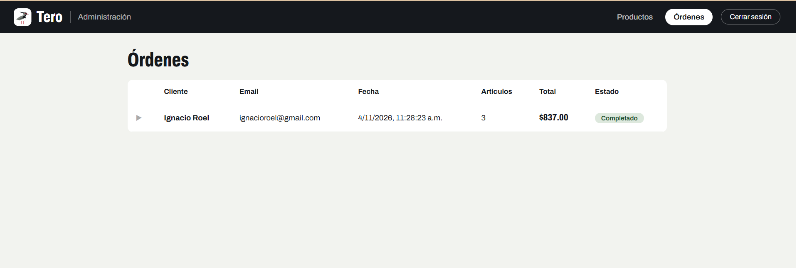

# Evidencia: imágenes de contenedores y prueba del compose (DEV-12)

## 1. Reducción de tamaño de imágenes

Medición con `docker image ls` (disk usage) y content size, antes y después de aplicar Dockerfiles multi-stage con imágenes base mínimas.

| Servicio | Antes (disk / content) | Después (disk / content) | Reducción aprox. | Base final |
|---|---|---|---|---|
| ui | 1.72 GB / 426 MB | 249 MB / 62.7 MB | ~85 % | node:22.23.4-alpine |
| admin | 1.73 GB / 426 MB | 247 MB / 62.2 MB | ~85 % | node:22.23.4-alpine |
| checkout | 2.03 GB / 465 MB | 329 MB / 72.3 MB | ~84 % | node:22.23.4-alpine |
| carts | 1.71 GB / 446 MB | 244 MB / 58.7 MB | ~86 % | python:3.12.16-slim |
| catalog | 2.26 GB / 570 MB | 38.5 MB / 9.33 MB | ~98 % | distroless nonroot |
| orders | 2.03 GB / 499 MB | 28.2 MB / 6.5 MB | ~99 % | distroless nonroot |

Técnicas aplicadas: multi-stage (build separado del runtime), dependencias de producción solamente, imágenes base mínimas con versión exacta fijada, `.dockerignore` por servicio.

## 2. Verificación de usuarios no-root

Salida de `docker compose top` con todos los servicios arriba:

| Servicio | UID | Usuario |
|---|---|---|
| ui, admin, checkout | 1000 | node |
| carts | 10001 | usuario no-root del Dockerfile |
| catalog, orders | 65532 | distroless nonroot |
| db, redis | 999 | usuarios internos de las imágenes oficiales |

Ningún proceso corre como root (UID 0).

## 3. Prueba del compose completo

Comandos: `docker compose down -v` y `docker compose up -d --build`, con `.env` creado desde `.env.example`.

- Los 8 servicios levantan y `db` queda `healthy`.
- Flujo probado de punta a punta: catálogo, carrito, checkout, creación de la orden y verificación de la orden en el panel de admin (puerto 8081).

